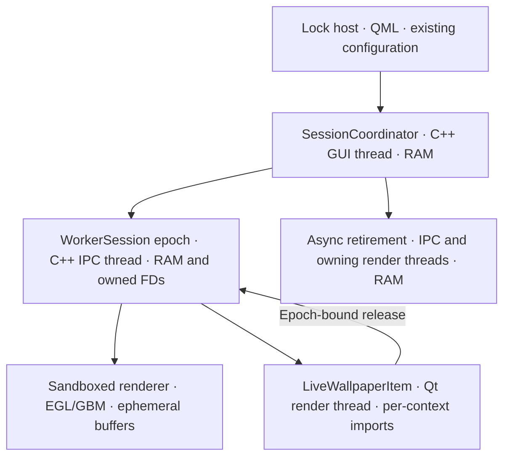
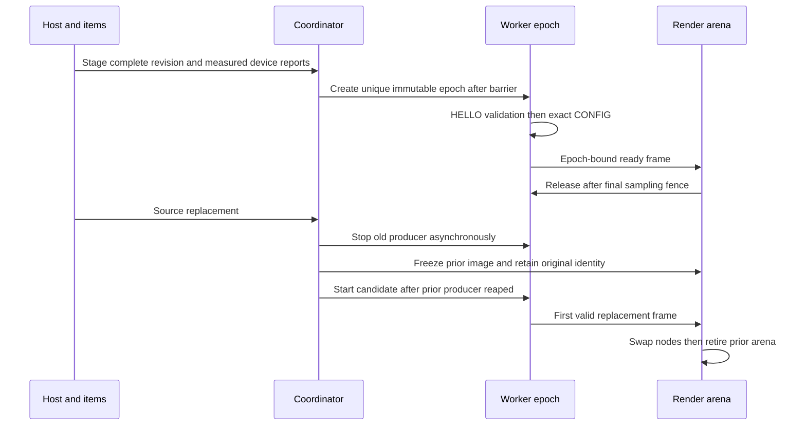
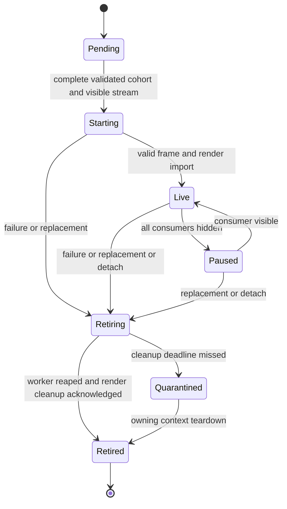

# Live lock bridge lifecycle revision

14 October 2026. The user approved the ownership-model redesign, reviewed this written revision and its implementation plan, and authorized implementation. The immutable epoch runtime is the first implementation gate; acceptance is not yet established. The original `live-lock-bridge` work unit remains stopped after two fix rounds.

## Scope and decision

This addendum replaces the native bridge's mutable current-broker ownership model in the [existing specification](live-lock-wallpapers.md). That specification remains authoritative for authentication, sandboxing, typed sources, desktop leases, spanning, tint, monitor power, installation and rollback. The [implementation plan](../superpowers/plans/2026-10-14-live-lock-bridge-lifecycle.md) replaces Task 3 of the original plan; downstream installation remains gated by the original rollout checks.

Choose a GUI session coordinator and immutable worker epochs. Each epoch is one worker attempt with a fixed source, measured render device, configuration and release endpoint. Source replacement and retry create different identities even when both workers start with slot 0/frame 1. A mutable broker with generation-indexed resource arenas is possible, but needs equivalent retirement machinery and retains the coupling that defeated the previous fixes.

Required outcomes: no launch from partial QML settings; no old frames or releases crossing worker identities; correct shared-side consumer masks; asynchronous cleanup; real GPU-item lifecycle evidence before rollout. There is no renderer rewrite, CPU frame transport, recorded loop, authentication change or new monitor-power policy.

## Requirements and limits

- Preserve independent lock wallpaper selection and 30-minute rotation, role-based main/side span, timeout/tint settings, hardware off/wake and user-stopped desktop behavior.
- Retain two streams, three slots per stream, eight consumers total across configured streams, 8192 pixels per dimension, 64 Mi pixels across streams and a 768 MiB aggregate transport-buffer budget. Include frozen and retiring allocations in this process-wide budget.
- Retain 30 FPS by default, allowed 1–60. No global Qt backend override or hardcoded DRM device/resolution fallback. Unsupported devices/backends use the existing background.
- Keep one producing worker process at a time. Replacement may retain one frozen prior resource arena and one candidate/current arena. Coalesce further requests to the latest desired snapshot; blocked cleanup prevents further allocation.
- Use the existing LWP1 wire structures. `Stream.consumers` is exclusively an eight-bit mask, never a count. Validate stream IDs by configured membership; a side-only stream with ID 1 is valid.

## Architecture and ownership

### Session coordinator

One coordinator per explicit lock or preview session token, held by a GUI-thread registry. Preview never acquires the desktop lease; lock start ends any active preview. It owns desired configuration, topology revision, registration tokens and per-consumer visibility, not sockets or textures. All state is ephemeral; existing shell configuration remains the persistence owner.

QML supplies one atomic `sessionConfig` object: `{revision, sourceId, sourcePath, fps, streams:[{id,width,height,consumers}], consumers:[{key,stream,id}]}`. Keys identify the expected surfaces and are unique within the session. Normalize streams by ID and consumers by key before equality/validation. Individual item bindings stage this snapshot and their own consumer key; they never launch a worker. Conflicting snapshots with the same revision fail validation. The complete topology is derived from existing WallpaperSpan geometry, including scale/transform data available from the host.

Commit requires component completion and registrations for every expected consumer, each reporting its actual OpenGL/EGL render-device identity from its attached window. Device disagreement, unavailable capabilities or an incomplete cohort after five seconds selects fallback. Initially covered consumers may delay this barrier until their scenegraph becomes available; locking and authentication never wait for it. An all-covered session keeps only pending desired configuration and starts on wake after capabilities become available. The registry does not guess missing consumers or devices.

Configuration, source, device or membership changes allocate a new epoch. Visibility changes alone do not: each stream is enabled if any registered consumer on it is visible, and the engine freezes when every stream is hidden. Same validated revision and configuration are idempotent. Removing a consumer uses its stored registration token, not IDs already changed by a setter, and creates a revised membership snapshot.

### Worker epoch and IPC owner

`WorkerSession` owns immutable `EpochId`, `SessionConfig` and the release endpoint. An atomic process-local monotonic uint64 allocator assigns a nonzero ID, also used as wire generation; exhaustion fails closed. The dedicated IPC thread owns socket, PID, buffer descriptors, deadlines and protocol state. GUI/render calls enqueue bounded commands and return immediately.

Every ready frame and lease stores a strong reference to its originating epoch plus stream, slot, sequence and consumer identity. Releases use that endpoint's fixed wire generation. A disconnected endpoint closes submitted descriptors and cannot forward them to another worker. Retry allocates a new epoch after one second, at most once per source per lock session; it never overwrites an old buffer map.

Outstanding obligations are bounded by six slots times eight consumers. A displayed lease may remain held across repaints; only submitted release fences start a timeout. Completed obligations and duplicate-detection records are removed when their slot/frame completes. Keep at most 64 queued control/release packets, coalesce visibility, and at most one pending delivered frame per consumer. Queue overflow fails the epoch without releasing sampled work as unsampled.

### Render owner

Each item's resource arena is keyed by epoch plus window/context serial. It owns imported FDs, EGLImages, GL textures, QSG wrappers and sampled leases on that window's render thread. Device reports and status changes reach the GUI through queued messages. Context/window changes disconnect old callbacks and retire the old arena before creating imports in the new context. The GUI never accesses mutable GL state.

A displayed frame remains leased until replaced or detached. Every draw refreshes its completion fence, including unrelated clock/password repaints. Fence creation/export failure retires the epoch; an older fence cannot certify the latest draw. An unsubmitted pending frame may release without a fence; a sampled frame must provide a valid native fence. A removed consumer stops delivery before draining pending and displayed leases. Node detachment precedes wrapper destruction.

## Contracts, flows and lifecycle

Native contracts: `stageDesired(SessionConfig)`, `registerConsumer(ConsumerKey, DeviceReport)` returning `RegistrationToken`, `setVisible(RegistrationToken,bool)`, and `detachConsumer(RegistrationToken)`. Only the coordinator constructs `WorkerSession(EpochId,SessionConfig)`. `FrameRef` retains that session; `release(FrameRef,ConsumerKey,SampleState,Fd)` transfers owned descriptors to its original endpoint. Events contain epoch and registration/context serials; stale events are dropped with descriptor cleanup. No contract accepts credentials, input events or display-power commands.

Retirement is one-way and idempotent. Handshake and buffer receipt have five-second total deadlines per phase, first visible frame ten seconds, ready/submitted-release fences one second. STOP allows two seconds graceful exit and a further two seconds for termination/reaping; all waits run on the IPC thread. Render cleanup has a five-second acknowledgement deadline. On missing acknowledgement, latch live rendering disabled for that session, hold only the bounded quarantined arena until context teardown, and retain fallback. Never force buffer reuse or GL destruction from the GUI.

After a producer has exited, its exported buffers remain immutable while existing imports retain their backing storage. Releases to its disconnected endpoint only close descriptors. The prior displayed arena can therefore remain frozen during candidate startup without another producing worker. Promote the candidate only after every currently visible consumer acknowledges its first valid import; the GUI then posts the same promotion serial to all those render arenas. Retire prior arenas after their swap acknowledgements. Failure before candidate readiness retains prior frozen content or the existing fallback; a frozen prior arena is retired on disable/unlock. No frame from a retired epoch can become current again. No new database, index, on-disk state or migration is introduced.

## Security, operations and rollout

Retain the original fail-closed bubblewrap namespace/mount/device allowlist and optional asynchronous QML Loader. Native module absence must leave the actual standard design and trusted authentication controls loadable. Capability reporting must describe measured availability, not advertise support unconditionally. Log phase, epoch ID, bounded failure enum and counters; never passwords, input, asset content or credentials.

This changes source and thread ownership inside the existing fork, not deployment scale or external APIs. Native source stays in the lock fork, transport source in the renderer fork, pins/installers in this repository. Preserve all unrelated dirty changes. No installer pin or activation changes until acceptance passes. Build against the installed Qt ABI; stage and validate artifacts before replacement, retain rollback, and install only while unlocked. Original nested-compositor and user-present lock tests remain mandatory.

## Acceptance and implementation sequence

1. Runtime contract tests capture actual CONFIG packets while permuting property and registration order; no early spawn, exact complete snapshots, masks 1/2/4/128, side-only stream 1, eight-consumer limit, unique retry identities, per-consumer visibility OR, bounded obligations/queues and asynchronous shutdown.
2. Actual `LiveWallpaperItem` GPU tests render through attached QQuickWindows on the measured device. Replace distinguishable sources that both begin with slot 0/frame 1; check calibrated pixels and release destinations. Exercise two side consumers, unrelated repaints, removal while sampled, reparenting and scenegraph invalidation. Inject failed imports and fence export after repaint. Unsupported/skipped GPU tests block rollout.
3. Integration/soak tests load the actual optional design with and without its module, validate source-failure routing and enable/disable, preserve power deadlines, and perform 100 source/topology transitions with bounded FD/import counts and no growth after warm-up. Under failure, GUI heartbeat gaps must remain below 250 ms; record actual cleanup latency, frame timing, device/Qt versions and memory high-water marks.

Review each implementation deliverable and its actual diff before the next dependent task. This is an approved replacement architecture, not a third patch round for the stopped work unit. Any new implementation unit still has at most two explicit fix rounds. Existing renderer/controller test results are prerequisites, not evidence for untested bridge transitions.

## References

- [Original scope, security and rollout](live-lock-wallpapers.md)
- [Qt scenegraph resource ownership](https://doc.qt.io/qt-6/qquickitem.html#graphics-resource-handling)
- [Qt render jobs and cleanup timing](https://doc.qt.io/qt-6/qquickwindow.html#scheduleRenderJob)
