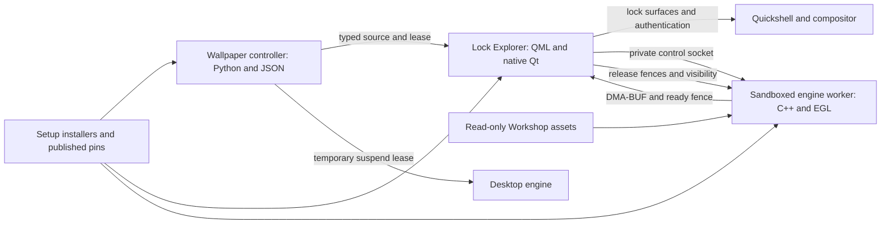
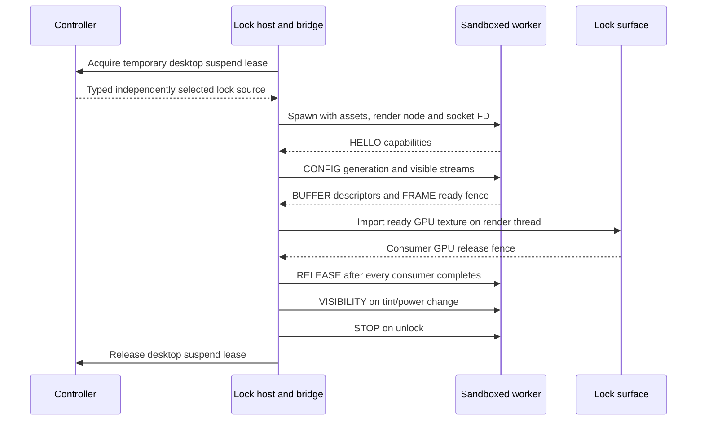
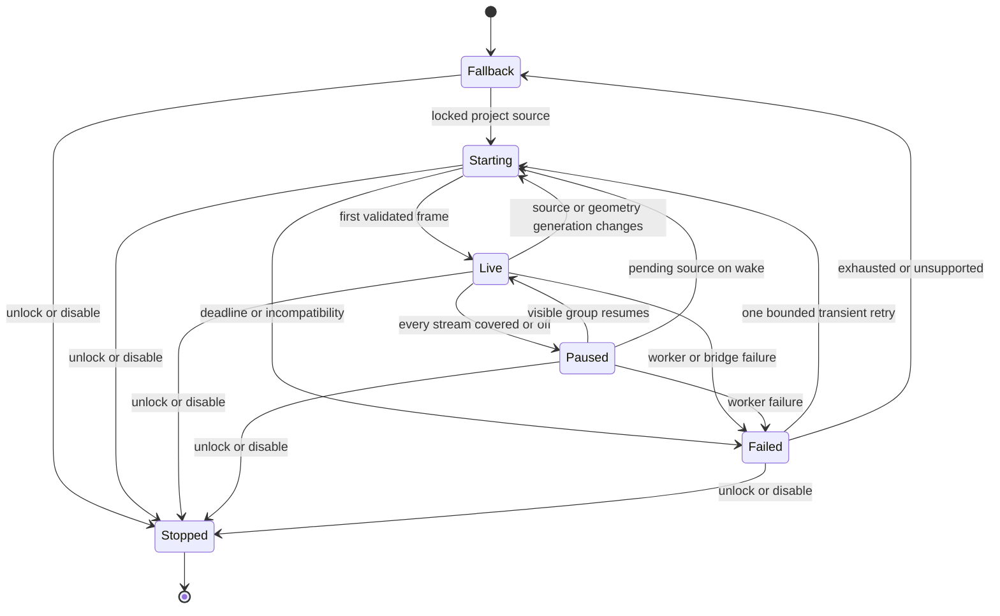

# Live lock wallpapers through an isolated GPU renderer

The [14 October 2026 bridge lifecycle revision](live-lock-bridge-lifecycle.md)
supersedes the native bridge's internal ownership model. Its approach is
approved, including the written revision and replacement implementation plan;
implementation is authorized and begins with the immutable epoch runtime.
The scope, security boundaries and rollout requirements below still apply.

Status: written design for review. Date: 2026-10-12. Product implementation has not started. The user selected an isolated renderer with GPU buffer sharing and rejected cached video loops.

## Scope and decisions

Lock Screen Explorer continues to own the Wayland session lock, authentication, tint, timeout, wake handling, and background composition. A separate sandboxed linux-wallpaperengine worker renders the selected Workshop project into GPU buffers. A small native Qt background item imports those buffers into the existing lock surfaces. Wallpaper code receives no authentication or input interface.

The existing lock wallpaper selection stays independent of the unlocked desktop. Preserve the current wallpaper choices, 30-minute rotation, main-monitor layout, portrait-side spanning, per-group timeout/tint settings, and verified side-monitor hardware power-off at 100% tint. Existing video wallpapers keep their direct QtMultimedia path. This feature introduces live scene rendering and live local web rendering to the extent supported by the Linux renderer; it cannot add missing upstream Wallpaper Engine features by itself.

Proposed release defaults requiring review: 30 FPS, offline and silent lock workers, no keyboard/mouse/audio-reactivity input, GPU transport with no CPU readback fallback, automatic pause of covered/off display groups, and temporary suspension of the desktop renderer while locked. Web wallpapers needing network access are unsupported in this release. The one downloaded web wallpaper, White Tree - Snow (1789171537), references local assets and is a suitable offline test case.

Proposed repository change requiring review: create the public fork `priyeshbhawsar15/linux-wallpaperengine` from `Almamu/linux-wallpaperengine`, initially based on commit `b016d7d1fdcf4e5fd2f9c9fa420a8aaa07fee02d`. Put the native Qt adapter in the existing Lock Screen Explorer fork, not a new user-facing plugin. Publish tested changes in this renderer fork and the existing lock-explorer and wallpaper-manager repositories before updating this setup's exact pins.

## Requirements and evidence

| ID | Requirement or constraint | Design and acceptance evidence |
| --- | --- | --- |
| R1 | Live Workshop rendering; no cached loops | Render the original project on demand; no recording or generated video files. |
| R2 | Isolated renderer with GPU sharing | Sandboxed worker, inherited socketpair, DMA-BUF frames and explicit fences. Verify actual cross-process import before lock integration. |
| R3 | Preserve locking and authentication | Existing WlSessionLock owns surfaces; optional background Loader; no password/input messages in worker protocol. |
| R4 | Preserve selection, span, tint, timeouts and hardware off | Typed source migration retains current selection; reuse WallpaperSpan and DisplayPower policies; rotations never reset inactivity deadlines. |
| R5 | Resource efficiency | Same-device GPU transport; 30 FPS; bounded buffer pools; pause invisible groups; reversible desktop suspension. |
| R6 | Fresh-install reproduction | Separate source repositories, published exact pins, idempotent build/install integration, PLUGINS.md and SCRIPTS.md updates. |
| R7 | Unsupported sources must leave a usable lock | Preserve fallback background; bounded retry; skip failed source for this lock session; authentication remains independent. |
| R8 | Existing settings and unrelated setup work survive | Preserve user configuration, including current side tint; use role-based monitor descriptions; isolate code changes from dirty setup files. |

Observed capability: Mesa on AMD Radeon RX 6800 advertises DMA-BUF export/import, modifiers, native fences, and surfaceless EGL. Qt 6.11 exposes native OpenGL texture wrapping. This is capability evidence, not a successful transport test. The actual Quickshell scenegraph backend and render device must be measured in the prototype. Reject unsupported backends or mismatched devices rather than changing the whole desktop's graphics backend.

The existing renderer web path uses CEF OnPaint and glTexImage2D: web rasterization already includes a CPU-to-GPU upload internally. DMA-BUF removes the additional renderer-to-lock frame copy; it does not make that upstream web path entirely zero-copy. Scene transport must have no CPU frame readback. Existing engine asset/video uploads are outside that transport boundary.

## Architecture

### Controller

Owner: existing wallpaper-manager repository. Technology: Python controller and existing service/timer. Storage: existing state directory, migrating `lock-video.json` to a versioned typed-source state and adding a temporary desktop-suspension lease. No database or network service.

Discover downloaded scene, web, and video projects plus existing local lock videos. Validate project metadata and confined source paths. Emit `video` or `project` sources with stable IDs. Keep shuffle-without-repetition and the 30-minute interval. The command that applies a source uses the existing Omarchy lock public interface extended with a typed source setter; legacy setVideo remains supported.

Only the controller changes desktop-renderer state. A runtime lease keyed by the lock owner PID and process start time suppresses rendering without changing the persisted user-enabled flag. Unlock, owner death, or lease recovery resumes the currently selected desktop wallpaper only if the user still wants it enabled. User stop while locked wins. Changing desktop selection while locked updates desired state for resume. The controller must handle its own service restart without losing the lease.

### Lock host and native bridge

Owner: existing lock-explorer fork. Technology: existing QML lock host plus a C++ Qt 6 QQuickItem/QSGTexture bridge. Storage: existing plugin configuration; runtime frame metadata only. Existing lock/authentication code remains the sole authority for accepting credentials and releasing the session lock.

Load a separate `LiveWallpaper.qml` asynchronously through an optional Loader. Only that component imports the native module. No unconditional native-module import in Service.qml or the normal wallpaper design. An absent module, Qt ABI mismatch, unsupported backend, or failed worker selects the current fallback and records a concise diagnostic. Existing video playback remains available.

The native broker validates IPC on a non-GUI thread, polls ready fences, and exposes only ready frames to render threads. Each window imports its own EGLImage/GL texture on its scenegraph thread and wraps it with QSGOpenGLTexture. Resource destruction occurs on that thread. Do not wait indefinitely for a worker fence on the GUI or render thread. Frames whose ready fence does not signal within one second are discarded and the worker generation is failed.

The bridge sends GPU release fences after the last draw that samples a slot. For the shared side stream, each consuming surface returns its own fence; the worker waits for all consumers before reusing that slot. Destroying a surface drains its GPU work before acknowledging release. Never assume frameSwapped alone proves GPU completion. Scenegraph invalidation terminates the generation and recreates imports after capability checks.

### Renderer worker

Owner: new linux-wallpaperengine fork. Technology: C++ engine library, a surfaceless EGL/OpenGL output driver, GBM DMA-BUF buffers and EGL native fences. Storage: none persistent; private temporary directory inside the sandbox. Assets are read-only. Use the current engine's project parsing and compatibility/property overrides.

One worker per selected project renders at most two independent output streams: main, and the bounding canvas of the side group. Reuse immutable parsed assets where the engine permits; do not assume animation state can be shared across different aspect ratios. A single side canvas is sampled by both side surfaces using the existing span geometry. An EGL worker must not require a hidden ordinary Wayland/GLFW window.

The worker selects the same DRM render device as the Qt consumer. Choose a mutually supported single-plane ARGB8888/XRGB8888 format and modifier; do not assume a linear layout. Output is opaque SDR sRGB, with a fixed documented top-left image origin and matching Qt texture-coordinate conversion; test channel ordering and vertical orientation with a calibration pattern. HDR output is outside this release. Three buffers per stream cap allocations and outstanding work. No free slot means skip rendering a new frame. Retire old generations after releases; a worker restart closes the private channel and all old resources.

For today's topology, the maximum native resolutions are main 3840×2160 and side canvas 2160×1920. Three RGBA slots for each are approximately 142 MiB before alignment, engine assets and compositor allocations. Geometry is role-based, derived from logical coordinates, transforms and scales. A group with mixed scales renders at the largest scale with correctly mapped crops. Initial limits: two streams, eight consumers, 8192 pixels per dimension, 64 Mi pixels total across streams and 768 MiB transport-buffer budget. Oversized layouts use the existing fallback and report the reason.

### Setup and installation

Owner: arch-setups. Technology: shell installers and existing shared helpers. Storage: published commit pins and build manifests. No plugin source copied into this repository and no submodule added.

Add a dedicated renderer installer registered in install-all.sh; keep the current desktop renderer installation operational until its compatibility checks pass. Build the pinned renderer worker and Qt bridge into feature-owned paths under `~/.local/lib/omarchy/lock-live/`. Record renderer commit, lock commit, Qt build version/ABI, architecture, compiler/build options and successful capability checks. Treat a matching revision and manifest as already installed; rebuild after Qt changes. Runtime failure must still fall back safely before a rebuild.

Install the native bridge before enabling the live component. Use staged builds and atomic replacement, preserve prior artifacts for rollback, and retain the existing installer's unlocked-session guard. Disabling Lock Explorer ends the worker and desktop lease and disables its controls. Disabling live rendering alone returns to existing backgrounds without changing tint/timeouts. Removal deletes feature artifacts and installer registration, backs up state, and preserves built-in plugins and unrelated configuration.

## Core flows

Acquire the desktop lease only after the lock host starts; it is never a precondition for locking. Start project workers only while a session is actually locked. Explorer preview uses an explicit short-lived preview session without acquiring a desktop lease or altering power state. Video sources use the existing player.

Changing source or geometry increments a generation. Keep the existing background until the first valid replacement frame, then atomically switch the source shown. A failed new source retains a usable fallback and never changes lock ownership. The same generation/configuration request is idempotent; stale frames are closed and discarded.

Tint changes affect composition immediately. A group at 100% tint needs no animated output; disable its stream independently of whether DPMS/DDC has completed. If every group is covered/off, freeze engine animation and its clock. Resume on existing wake/activity handling with fresh frames; rendering never performs monitor power commands. Inactive streams hold their last valid frame for a wake transition. Rotation while all groups are inactive updates pending selection and starts it only when a group becomes visible, without resetting deadlines.

## Private protocol and errors

Transport: inherited AF_UNIX SOCK_SEQPACKET socketpair, SCM_RIGHTS descriptors, no filesystem listener. The bridge launches the worker; the channel itself is the capability. Clear unrelated inherited descriptors and environment. Protocol version 1 uses fixed-size little-endian structures, no serialized object graphs, no arbitrary command strings and no paths in frame messages.

Header: magic `LWP1`, major version, message type, payload bytes, generation uint64 and monotonically increasing sequence uint64. Cap each packet at 4096 bytes and ancillary FDs at eight. Validate exact length/type, reserved bits, positive dimensions, overflow-safe pitch/offset arithmetic, configured budgets, device identity, known IDs and generation before importing. Close every descriptor on reject/disconnect, set CLOEXEC, and reject MSG_TRUNC/MSG_CTRUNC or unexpected descriptor counts.

| Message | Sender | Payload and descriptor rules |
| --- | --- | --- |
| HELLO | Worker | Supported protocol, device major/minor, formats/modifiers, engine build. No FDs. Bridge replies only with a compatible configuration. |
| CONFIG | Bridge | Generation, stream IDs/dimensions, 30-FPS target and per-stream consumer IDs. No FDs. Source/assets are fixed at spawn. |
| BUFFER | Worker | Stream/slot, width/height, fourcc/modifier, pitch/offset; exactly one DMA-BUF FD. Only three slots per configured stream. |
| FRAME | Worker | Stream/slot, frame sequence, presentation timestamp; exactly one native ready-fence FD. Cannot overwrite a leased slot. |
| RELEASE | Bridge | Stream/slot/frame and consumer ID; exactly one consumer release-fence FD, or zero only when never submitted for sampling. Worker reuses only after every expected release fence signals. |
| VISIBILITY | Bridge | Enabled streams and freeze-clock flag. No FDs; idempotent. |
| ERROR | Either | Fixed enum: unsupported backend/device/format/source, invalid protocol, resource limit, timeout, render failure. Bounded diagnostic string; no assets or secret data. |
| STOP | Bridge | Graceful shutdown request. No FDs. Exit within two seconds, then terminate/kill within a further two seconds. |

An unsignaled ready/release fence is not reused by timeout. Tear down that worker generation and its imports safely; resume only with new allocations. Worker protocol/format errors fail the current source immediately. Five seconds to handshake and ten seconds to first frame; transient exit gets one retry after one second per source per lock session. The controller gets only status/source IDs, never frame FDs or credentials.

## Data and persistence

`lock-video.json` becomes version 2 while retaining its filename for migration. Fields: `version:2`, `activeSource:{kind,id,path,workshopId?}`, legacy `activeVideo` while the source is video, `lastChanged`, `intervalMinutes:30`, and `shuffleRemaining` of stable typed IDs. Existing selected local video and rotation timestamp migrate exactly. Write atomically; do not destructively rewrite the old state until typed-source support is installed on both sides. Legacy video setters and old state remain accepted. If downgrade cannot understand a project, restore the last known video/fallback without replacing user selections globally.

A source ID identifies a downloaded Workshop ID or canonical local video path. Validate paths against explicitly permitted roots before launch; resolve symlinks and reject escapes. Do not execute project scripts on the host. Missing/deleted projects leave their IDs out of discovery. Failure exclusions are in-memory per lock session and do not remove Workshop files or blacklist permanently. A bounded candidate scan tries each discovered source at most once before settling on fallback.

The controller's runtime lease stores owner PID/start time, lease token and generation atomically under its existing runtime directory. It stores no passwords and never overwrites persistent enabled/selection settings. On restart compare owner liveness/start time before honoring it. One current owner is sufficient on this machine; no distributed coordination or database indexes are needed.

Existing plugin configuration retains DisplayPower and wallpaper-span fields and adds `liveWallpaper.enabled`, `liveWallpaper.fps` (default 30, allowed 1–60) and a typed source field. Offline/silent restrictions are fixed for this first release rather than offering misleading toggles. Existing Explorer controls use dynamic Aether tokens. Buffer and fence IDs exist only in memory; logs record phase, source ID, failure enum and timing, never credentials or wallpaper contents. Rotate logs with existing service retention.

## Lifecycles and consistency

| Stateful owner | States and guarded transitions | Effects, retry and recovery |
| --- | --- | --- |
| Lock worker session | Fallback/Starting/Live/Paused/Failed/Stopped as diagram; Starting also accepts new source generation. Unlock/disable ends every active state. | Optional worker never owns lock; stale generation cannot return to Live. Deadlines and single retry as above. New lock session clears failures. |
| Buffer slot | Free → Rendering → Ready → Leased → Releasing → Free. All consumers/fences must finish before Free. | Dropped unsubmitted Ready frames can release without sampling. Never reuse Leased on timeout. Disconnect retires the generation; close FDs and destroy imports on their owning threads. |
| Desktop lease | Absent → Held on lock; Held → Absent on unlock/death/disable. Recovery validates process identity. | Acquire/release token operations idempotent. Unknown or stale releases ignored. Persistent user stop always prevents resume. |
| Rotation | Selected → Pending on interval/change while covered; Pending → Selected after source applied; failed candidate excluded for session. | Preserve shuffle and timestamp semantics; timer never wakes displays or resets power deadlines. Pending changes coalesce to the latest source. |
| Installation | Current → Staged → Validated → Activated, or Staged/Validated → Rejected. | Current artifacts remain until atomic activation; unlocked guard required. Failed builds leave installed behavior intact. Rollback restores prior pin/artifact manifest. |

Invalid state messages are rejected without granting slot ownership. Control requests are sequenced by the bridge; render-thread releases include generation and frame sequence. No promise of exactly-once frame display is needed: dropping frames is permitted, drawing stale or overwritten buffers is not. The compositor and existing auth service have their own unchanged lifecycles.

## Security and permissions

Launch through bubblewrap with private user/mount/PID/IPC/network namespaces, read-only allowlisted engine/runtime libraries, assets and chosen DRM render node. Provide minimal /proc and /dev, private tmpfs HOME/cache, required CEF helper binaries, and only the inherited frame/control channel. No normal Wayland socket, X11 connection, session bus, PulseAudio/PipeWire sockets, home directory, credentials, Steam login data or writable host path. Deny networking and route audio to a null implementation. Explicitly include only assets needed by validated project dependencies; reject path escapes and ensure read-only mounts are not aliases to broad host directories.

Use no-new-privileges, resource caps and syscall restrictions compatible with Mesa/CEF. Keep CEF subprocesses inside the same outer sandbox and remove unnecessary relaxed web-security/debug switches for lock mode. Do not assume CEF's own sandbox is sufficient. Verify namespace restrictions through an instrumented test worker, not just command-line inspection. If required namespaces or GPU capabilities are unavailable, report unsupported and retain fallback; never silently launch unsandboxed.

The renderer can affect pixels only inside the wallpaper item, below an opaque authentication card, tint and trusted lock indicators. It cannot create windows, inject input, power monitors, unlock or cover trusted controls. No keyboard/pointer content is forwarded, even for web projects. The importer is small but still part of the lock process's graphics attack surface: malformed metadata validation and sandboxing reduce risk, not a proof of immunity to GPU-driver vulnerabilities. If the entire locker crashes, rely on the compositor's ext-session-lock failure behavior; prove this in a disposable nested test before a real session test. Never build an automatic unlock-on-crash path.

## Failures and operational recovery

Missing module/Qt ABI mismatch: use legacy background, show status in Explorer when unlocked, rerun installer to rebuild. Non-OpenGL scenegraph or device mismatch: no global graphics override; report unsupported and revisit a backend-specific importer only with a revised design. Worker crash/hang: retain fallback, bounded restart then skip source. DMA-BUF exhaustion/fence timeout: terminate generation, release imports safely and reduce activity; do not force slot reuse. Hotplug/scale/transform changes: re-resolve monitor roles, retire old generation and rebuild streams while preserving lock and deadline state. All displays off: pause renderer; wake uses existing verified hardware power code first, then visibility resume.

If no projects can run, the lock uses its existing video/image background. A degraded renderer never blocks authentication or pauses power recovery. To recover, unlock normally, inspect bounded diagnostics, disable liveWallpaper, or rerun the pinned installer. Never update lock authentication code while the session is locked. Test and install only during an unlocked window; no automatic unlock command.

## Deployment and resource targets

Single machine, one lock session, one selected-project worker with CEF subprocesses only for web sources. No remote API, cloud service or background network fetch. Fetch source dependencies during authorized installation, not while locked. Build against system EGL/GBM for the bridge and worker; isolate bundled CEF EGL/GLES libraries to prevent symbol/device mismatches. Record upstream/fork URLs, exact published hashes and modifications in PLUGINS.md; document every installer/helper shell script in SCRIPTS.md.

Acceptance targets: a supported local scene produces a first frame within ten seconds; render target 30 FPS at actual configured geometry with no growing queue; no main-thread blocking fence waits; no CPU readback in the shared-frame transport; stable FD/GPU memory counts across 100 rotations and monitor-generation changes; authentication input remains responsive under worker stalls. Record frame timing, resident/GPU memory, render-device identity, engine build and CPU/GPU utilization against the existing desktop renderer with the same scene. These are measured acceptance checks, not claimed current results or a universal performance guarantee.

When all groups are hidden, rendering stops and GPU usage returns toward idle; the paused process can retain bounded assets/buffers. The desktop renderer must not render concurrently while the lease is held. The importer may consume driver/compositor-internal copies depending on negotiated format; call the path verified GPU sharing rather than asserting every driver operation is zero-copy.

## Verification, rollout and rollback

1. Prove surfaceless EGL worker → DMA-BUF → native Qt item outside the real locker, on the actual Quickshell backend/device. Test modifier negotiation, fences, two side consumers, visibility and disconnect. Stop the feature if this GPU-sharing milestone fails; do not substitute recorded loops or CPU frame streaming.
2. Add engine project rendering with existing per-project compatibility overrides. Verify representative scene projects and the local White Tree web project. Measure web's internal CEF upload separately. Classify unsupported engine features explicitly.
3. Verify protocol validation with truncated packets, extra/missing FDs, stale sequences, overflowed sizes, unknown slots, failed imports and permanently unsignaled fences. Prove no descriptor growth or GUI-thread deadlock. Test sandbox denial of host files, networking, session sockets and arbitrary display surfaces.
4. Verify typed-source migration, legacy setters, bounded failed-source rotation, plugin disable/re-enable, desktop user-stop behavior, owner/controller crashes, hotplug and Qt-module absence. Test the optional Loader in the existing locker with the native module deliberately unavailable.
5. Integrate background-only rendering and test fail-closed lock ownership in a nested compositor. Then conduct a short actual locked-session test with the user present: correct main and side crops, responsive authentication, tint/timeouts unchanged, DDC-off sides stop rendering and wake safely, unsupported project and worker crash preserve usable lock.
6. Publish authorized renderer, lock and controller commits; verify hashes are fetchable; update setup pins, role-based configuration and documentation together. Run fresh-install and repeat-install checks in a staged environment, then install on this unlocked machine. Do not incorporate unrelated dirty changes.

Roll out behind liveWallpaper.enabled, enabling it only after the GPU and lock tests pass. Rollback disables live rendering, terminates its worker/lease, restores prior published pins and staged artifacts, and preserves existing wallpaper/power selections. No cached recordings exist to clean up. Required implementation plan follows approval of this written specification.

## References

- [Qt native OpenGL texture wrapping](https://doc.qt.io/qt-6/qnativeinterface-qsgopengltexture.html)
- [EGL DMA-BUF export](https://registry.khronos.org/EGL/extensions/MESA/EGL_MESA_image_dma_buf_export.txt)
- [EGL native fence synchronization](https://registry.khronos.org/EGL/extensions/ANDROID/EGL_ANDROID_native_fence_sync.txt)
- [ext-session-lock protocol](https://wayland.app/protocols/ext-session-lock-v1)
- [Bubblewrap implementation and limitations](https://github.com/containers/bubblewrap)
- [Renderer output interface](https://github.com/Almamu/linux-wallpaperengine/blob/b016d7d1fdcf4e5fd2f9c9fa420a8aaa07fee02d/src/WallpaperEngine/Render/Drivers/Output/Output.h)
- [Existing CEF frame upload](https://github.com/Almamu/linux-wallpaperengine/blob/b016d7d1fdcf4e5fd2f9c9fa420a8aaa07fee02d/src/WallpaperEngine/WebBrowser/CEF/RenderHandler.cpp)
